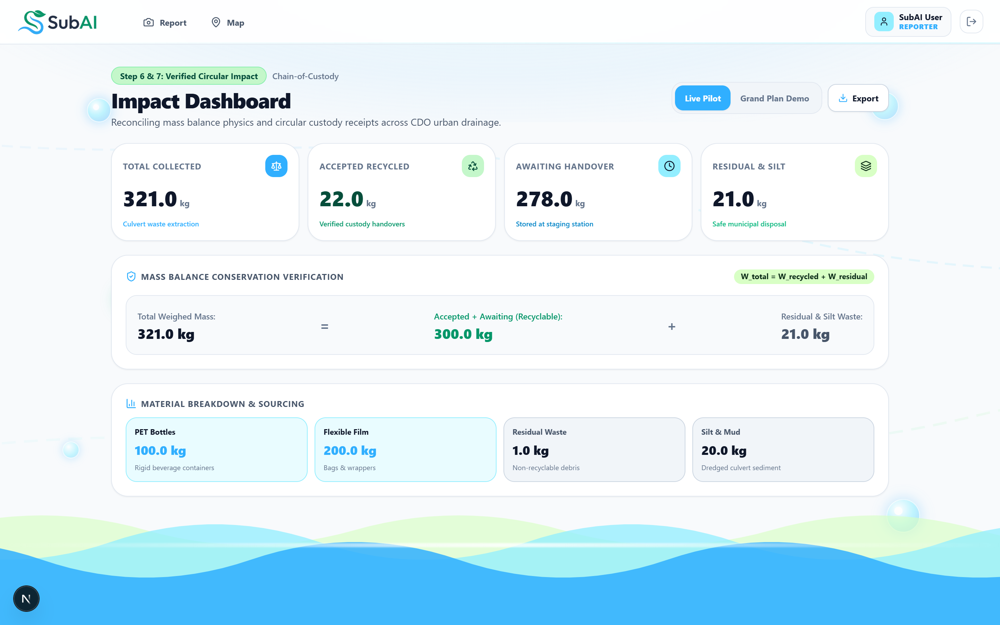
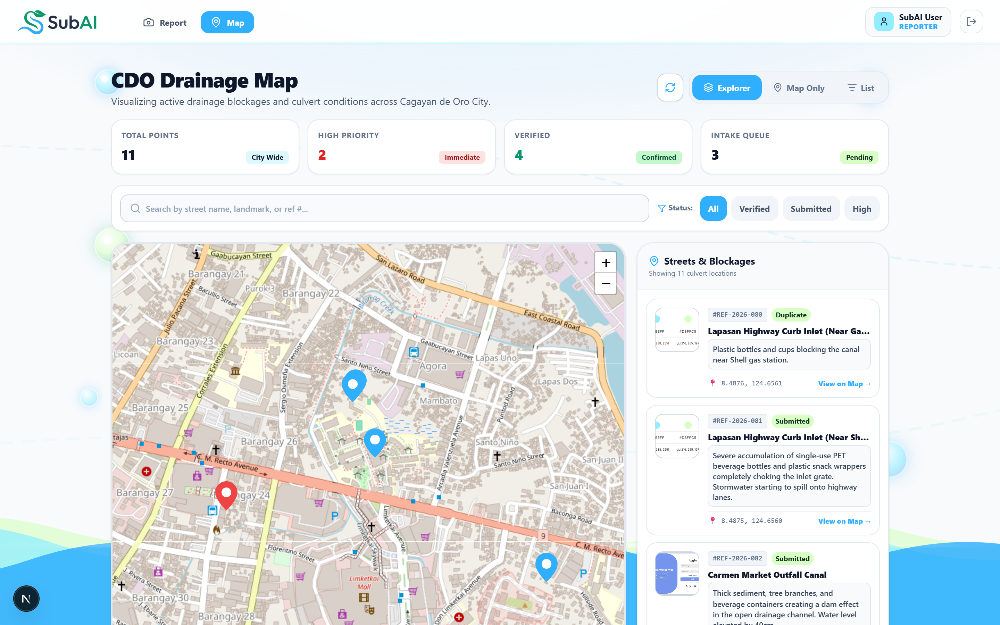
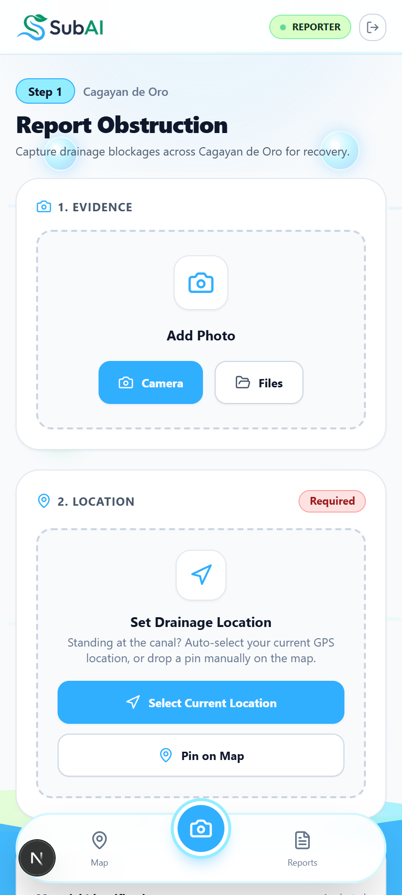
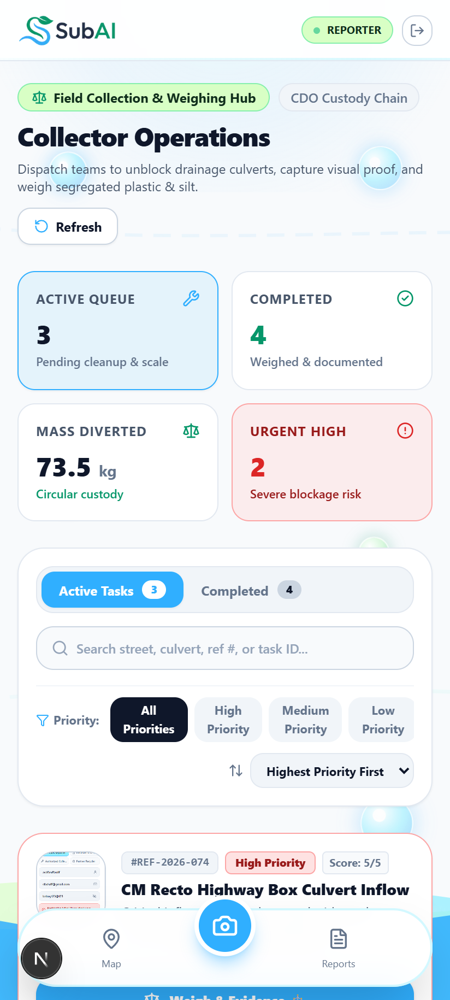
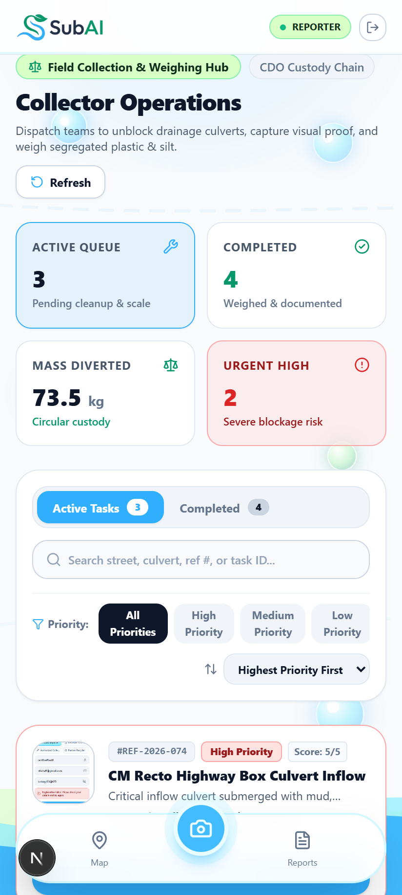
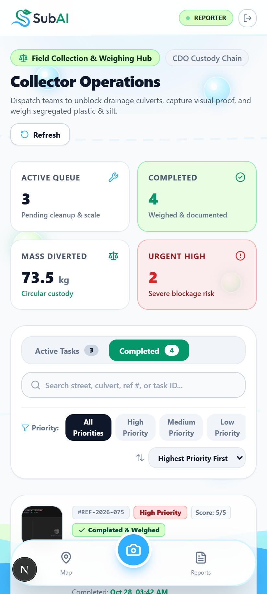
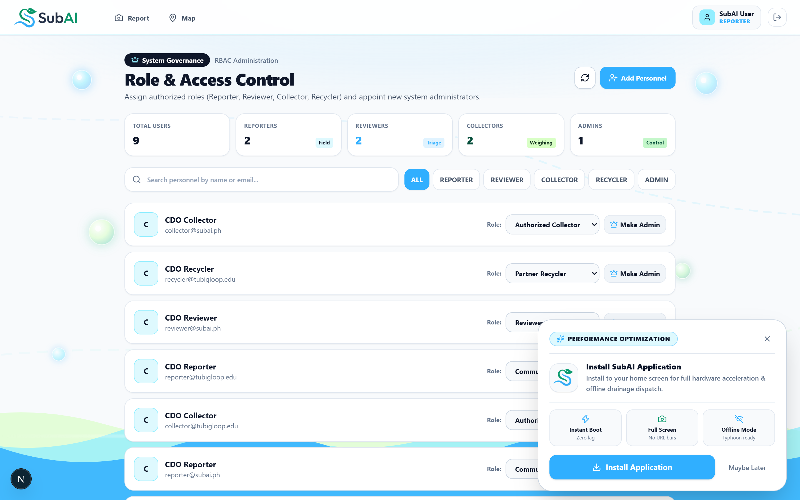

# 🌊 SubAI CDO — Circular Urban Drainage & Waste Recovery

<p align="center">
  
</p>

<p align="center">
  <strong>AI-Powered Culvert Obstruction Triage, Verified Circular Waste Recovery, and Flood Resilience for Cagayan de Oro City.</strong>
</p>

<p align="center">
  <a href="https://nextjs.org"></a>
  <a href="https://react.dev"></a>
  <a href="https://tailwindcss.com"></a>
  <a href="https://firebase.google.com"></a>
  <a href="https://ai.google.dev"></a>
  <a href="https://leafletjs.com"></a>
</p>

---

## 📌 Executive Summary

Urban monsoon flooding in **Cagayan de Oro City (CDO)** is severely exacerbated by stormwater culverts choked with single-use plastics, unmanaged commercial packaging, and upstream sediment. 

**SubAI** transforms urban drainage maintenance into a verified **Circular Economy loop**:
1. **Citizens** capture photographic evidence of blocked culverts;
2. **Google Gemini 3.6 Flash** auto-classifies the drainage structure and debris fractions;
3. **Municipal Authorities** triage, prioritize (0–5 scoring), and dispatch cleanup teams;
4. **Field Collectors** log verified batch scale weights or qualitative clearances with before/after photos;
5. **Recyclers** receive recovered plastic batches with real-time remaining custody balance accounting.

---

## 📸 System Showcase Gallery

### 1. Operations Command & Geospatial Intelligence
<p align="center">
  
  
</p>

### 2. Citizen Reporting & Field Execution (Mobile First)
<p align="center">
  
  
  
  
</p>

---

## 🔄 The 7-Step Closed-Loop Lifecycle

SubAI enforces strict mathematical and auditable governance across all 7 stages of culvert maintenance:

```text
[1. Submit] ──► [2. Review] ──► [3. Assign] ──► [4. Collect] ──► [5. Hand Over] ──► [6. Confirm] ──► [7. Close]
  Reporter         Reviewer        Reviewer        Collector        Collector+Recycler  Reviewer        Reviewer
```

| Step | Actor | Action & Core Rules | Output Record |
| :---: | :--- | :--- | :--- |
| **1. Submit** | **Reporter** | Photo capture, campus site (`ustp-cdo-main`), description, GPS pin + **"Select Current Location"** auto-geolocate, dataset origin (`pilot`). AI automatically detects PET bottles, flexible plastics, silt, and structure type. | `ReportItem` with GPS & AI tags |
| **2. Review** | **Reviewer** | Triage states (`Verified`, `Needs inspection`, `Rejected`, `Duplicate`). When marked **Duplicate**, links to original report ID (`duplicate_of_id`) to prevent duplicate dispatches while keeping full audit history. | Review status & timestamp |
| **3. Assign** | **Reviewer** | Calculates priority using CEIW Matrix: $\text{Obstruction Level (0–3)} + \text{Disruption Score (0–2)} = 0\text{–}5\text{ Priority}$. Dispatches authorized crew with target date. **Enforces only one active task per report**. | Active `CleanupTaskItem` |
| **4. Collect** | **Collector** | Before & after clearance photos, completion date, and material category mass weights ($\text{PET} + \text{Flexible} + \text{Silt} + \text{Residual}$). Includes **"Scale Measurement Unavailable"** toggle for qualitative clearance without polluting the numeric mass ledger. | `CollectionBatchItem` with weights |
| **5. Hand Over** | **Collector & Recipient** | Hands over diverted plastics to partner facility (*CDO MRF Lapasan*, *Green Loop*, *NM Plastic Recovery*). Records accepted weight and scale receipt photo. **Leaves visible remaining balance in custody**: $$\text{Remaining Balance} = \text{Submitted kg} - \text{Accepted kg}$$ | `HandoverItem` (`pending`) |
| **6. Confirm** | **Reviewer** | Reviewer audits weigh ticket photo and validates accepted vs submitted quantities. Reviews partial balances and issues `[Confirm Handover]` or `[Reject Handover]`. | Confirmed handover receipt |
| **7. Close** | **Reviewer** | When all batches have documented disposition, reviewer executes `[Close Task (Step 7)]` with auditable disposition notes. | Permanently closed task |

---

## ⚖️ Mathematical Mass Balance Ledger

To prevent phantom metrics, SubAI strictly enforces mathematical mass conservation:

$$\text{Total Weighed Mass (kg)} = \sum (\text{PET} + \text{Flexible Packaging} + \text{Residual Trash} + \text{Silt})$$

- **Unmeasured Field Clearances**: If crews clear remote ditches without hanging scales, toggling *"Field Scale Unavailable"* logs `is_unmeasured: true` and `measured_kg: 0`, preventing dummy numbers from contaminating citywide recycling statistics.
- **Chain of Custody**: Materials remain tracked under collector custody until acknowledged by a registered MRF receipt.

---

## 🤖 Multimodal Vision AI Architecture

When a citizen snaps a photo, SubAI runs a fast multimodal analysis cascade via **Google Gemini Vision**:

```text
[ Camera Capture ] ──► [ Canvas Compression ] ──► [ /api/analyze ] ──► [ Gemini 3.6 Flash ]
   Raw Mobile Photo       960x960 @ 0.72 JPEG         Server Route          Multimodal Analysis
```

- **Candidate Cascade**: Automatically falls back across `gemini-3.6-flash`, `gemini-3.5-flash`, and `gemini-3.1-flash-lite`.
- **Honest Offline Policy**: If cellular connectivity fails or API keys are missing, the system informs the user and lets them select tags manually—**it never injects fake pre-filled tags**.
- **Supported Classifications**: `Curb Inlet`, `Catch Basin`, `Open Canal`, `Culvert`, `Creek Outfall`.

---

## 🗺️ Geospatial Intelligence & Cagayan de Oro Pilot

SubAI is calibrated for the specific topography and monsoon runoff patterns of Cagayan de Oro City:

<p align="center">
  
</p>

- **Target Hotspots**: CM Recto Highway, Lapasan Highway Culverts, Bitan-ag Creek Outfall, Cogon Public Market, Carmen Market, and USTP Campus.
- **One-Tap GPS**: High-accuracy `navigator.geolocation` integration with automated OpenStreetMap reverse geocoding.
- **Flood Retention Modeling**: Integrates with `/rain-bank` to project stormwater diversion into campus rainwater harvesting cisterns.

---

## 👥 Role-Based Access Control (RBAC)

<p align="center">
  
</p>

SubAI enforces role boundaries across 5 municipal user profiles:

| Role | Allowed Routes | Primary Responsibilities |
| :--- | :--- | :--- |
| **Citizen Reporter** | `/report`, `/map` | Captures geo-referenced photo evidence of blocked culverts. |
| **Review Authority** | `/review`, `/map`, `/dashboard` | Triages reports, links duplicates, scores priority, and confirms MRF handovers. |
| **Field Collector** | `/tasks`, `/map` | Executes drainage cleanouts, records scale batch weights, and logs handovers. |
| **Partner Recycler** | `/dashboard`, `/tasks` | Issues digital receipts and accepts diverted PET/polyolefin batches. |
| **System Admin** | All routes (`/admin`, etc.) | User governance, RBAC role reassignment, and audit telemetry. |

---

## 💻 Tech Stack

| Component | Technology | Role |
| :--- | :--- | :--- |
| **Frontend & Framework** | [Next.js 16.4.2](https://nextjs.org/) (Turbopack, App Router) | SSR, Server Actions, Route Handlers |
| **UI Library** | [React 19.3.0](https://react.dev/) + TypeScript 5 | Modern component architecture |
| **Styling** | [Tailwind CSS v4](https://tailwindcss.com/) | Brand tokens (`#30AFFF`, `#92EEFF`, `#D8FFC5`, `#C4F7CA`) |
| **Database** | [Cloud Firestore](https://firebase.google.com/docs/firestore) | Real-time collections for reports, tasks, and handovers |
| **Authentication** | [Firebase Auth](https://firebase.google.com/docs/auth) | Secure sessions with RBAC profile sync |
| **AI Vision** | [Google Gemini 3.6 Flash](https://ai.google.dev/) | Multimodal drainage and material identification |
| **Mapping & GIS** | [Leaflet 1.9.4](https://leafletjs.com/) | OpenStreetMap raster layers and marker clustering |
| **Iconography** | [Lucide React](https://lucide.dev/) | Clean, accessible system icons |

---

## 🚀 Getting Started

### Prerequisites
- Node.js 20+ (Node 22 LTS recommended)
- npm 10+
- Google Cloud / Firebase Project with Firestore and Auth enabled
- Google Gemini API Key from [Google AI Studio](https://aistudio.google.com/)

### Installation

1. **Clone the repository**:
   ```bash
   git clone https://github.com/JRSstuff/SubAI.git
   cd SubAI
   ```

2. **Install dependencies**:
   ```bash
   npm install
   ```

3. **Configure environment variables** (`.env.local`):
   ```env
   # Firebase Configuration
   NEXT_PUBLIC_FIREBASE_API_KEY=your_firebase_api_key
   NEXT_PUBLIC_FIREBASE_AUTH_DOMAIN=your_project.firebaseapp.com
   NEXT_PUBLIC_FIREBASE_PROJECT_ID=your_project_id
   NEXT_PUBLIC_FIREBASE_STORAGE_BUCKET=your_project.firebasestorage.app
   NEXT_PUBLIC_FIREBASE_MESSAGING_SENDER_ID=your_sender_id
   NEXT_PUBLIC_FIREBASE_APP_ID=your_app_id
   NEXT_PUBLIC_FIREBASE_MEASUREMENT_ID=your_measurement_id

   # Google Gemini Vision API Key
   GEMINI_API_KEY=your_google_ai_studio_key
   ```

4. **Run the local development server**:
   ```bash
   npm run dev
   ```
   Open [http://localhost:3000](http://localhost:3000) in your browser.

5. **Build for production**:
   ```bash
   npm run build
   npm run start
   ```

---

## 📊 Presentation Pitch Deck & Screenshot Assets

All high-resolution 2× Retina presentation slides and speaker talking points are organized in the project:
- **Presentation Deck Guide**: [`PRESENTATION_PITCH_DECK.md`](./PRESENTATION_PITCH_DECK.md)
- **Desktop Screenshots (14 files)**: `./public/presentation_screenshots/desktop/`
- **Mobile Screenshots (14 files)**: `./public/presentation_screenshots/mobile/`
- **Demo Data Seed Script**: `node scripts/seed_demo_data.js`
- **Demo Data Cleanup Script**: `node scripts/cleanup_demo_data.js`

---

## 📄 License

Developed for the **CEIW 2026** urban drainage and circular economy pilot in Cagayan de Oro City. All rights reserved.
