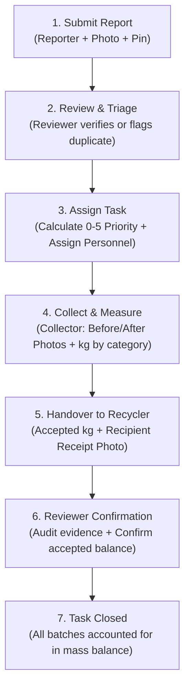

# SubAI CDO: Master Project Plan & Execution Checklist

> **Urban Pilot & Software Prototype for CEIW 2026 (Green Innovation Pitching Competition)**  
> **Challenge Area**: Low-waste, Climate-Smart Urban Drainage & Circular Recovery
> **Core Premise**: *"Software ra atong product. Atong trabaho kay klarohon ang report, assignment ug evidence. Ang actual cleanup ug recycling kay sa participating personnel ug partners."*  
> (Our software coordinates information, assignments, and verified chain-of-custody evidence; physical handling and weighing are performed by authorized personnel and recycler partners.)

---

## 1. Executive Summary & Purpose

SubAI CDO is a Progressive Web App (PWA) designed for Cagayan de Oro to transform drainage obstruction reports into verified cleanup tasks, measured material batches, and auditable recycling handovers.

### What Success Means
- **Full Traceability**: A reviewer or auditor can trace a single campus report from initial photo submission all the way to verified collection, measured kilogram weighing, and confirmed recycler handover.
- **Strict Mass Balance**: Dashboard metrics reconcile mathematically to underlying records, preventing double-counting between collected kilograms and accepted recycling.
- **Fail-Safe Operation**: Core functions remain completely operational if Gemini AI quotas are exceeded or OpenStreetMap tiles are unavailable.
- **Truth in Presentation**: Pilot data and demonstration data are strictly isolated and labeled; no misleading flood-prevention guarantees or unverified claims.

---

## 2. Adapted Modern Tech Stack (Vercel Serverless Architecture)

*Note: Adapted from the legacy Vite/Pages plan to our high-performance Next.js 15 App Router & Vercel stack.*

| Layer | Technology | Operational Responsibility |
| :--- | :--- | :--- |
| **Frontend Framework** | **Next.js 15+ (App Router, React 19, TS)** | Mobile-first PWA and desktop command interfaces, server components, client interactivity. |
| **Styling & UI Tokens** | **Tailwind CSS v4 + Brand Palette** | Responsive box layouts, zero gradients, brand tokens (`#30AFFF`, `#92EEFF`, `#D8FFC5`, `#C4F7CA`). |
| **Micro-Animations** | **Framer Motion (`framer-motion`)** | Smooth native PWA gestures, sliding panels, modal sheets, and transitions. |
| **Iconography** | **Lucide React** | Consistent, accessible iconography across forms, maps, and status badges. |
| **Backend & APIs** | **Next.js Server Actions & Route Handlers** | Secure serverless API execution, data validation, rate limiting, and Gemini proxying. |
| **Database & Auth** | **Supabase (PostgreSQL + RLS + Auth)** | Relational schemas, row-level security for role boundaries, auditable status histories. |
| **Storage** | **Supabase Private Storage** | Private evidence photo storage (`report-photos`, `handover-evidence`) with signed URLs. |
| **Mapping & GPS** | **Leaflet + React-Leaflet + OSM** | Zero-cost tile mapping, campus GPS pin drop, task location list fallback. |
| **AI Vision Engine** | **Gemini 2.5 Flash (`@google/genai`)** | Serverless multimodal analysis for waste categorization suggestions (with human override). |
| **Deployment** | **Vercel Serverless** | Automated CI/CD, global edge caching, zero maintenance hosting. |

---

## 3. User Roles & Access Boundaries

| Role | Primary Need & Workflow | Permitted Access Scope |
| :--- | :--- | :--- |
| **Reporter** | Submit report with photo and location, view receipt, track progress. | Create reports; view status of own submitted reports. |
| **Reviewer** | Review incoming reports, triage priority (0–5), remove duplicates, assign tasks, confirm handovers. | Full access to review queues, task dispatching, and evidence confirmation for assigned site. |
| **Collector** | View assigned route/tasks, capture before/after evidence, enter measured weights, log handovers. | Access assigned tasks, submit collection batches and recipient handover receipts. |
| **Administrator**| Manage campus sites, configure role memberships, audit logs, data export. | System administration, user role assignments, audit log review. |
| **Public Viewer**| View public aggregate impact metrics and sanitized location pins (no private data). | Read-only access to `/dashboard` and public sanitized `/map`. |

---

## 4. End-to-End 7-Step Workflow & State Machine

### 4.1 State Definitions
- **Report Review States**: `Submitted` $\rightarrow$ `Needs inspection` $\rightarrow$ `Verified` | `Rejected` | `Duplicate`.
- **Cleanup Task States**: `Planned` $\rightarrow$ `Assigned` $\rightarrow$ `In progress` $\rightarrow$ `Collected` $\rightarrow$ `Awaiting disposition` $\rightarrow$ `Closed`.

### 4.2 Transparent Priority Scoring Algorithm (0 to 5)
Only *Verified* reports receive a calculated priority score:
1. **Observed Obstruction (0 to 2 pts)**:
   - `0`: Little or none
   - `1`: Partial obstruction
   - `2`: Substantial blockage
2. **Disruption to Campus Use (0 to 2 pts)**:
   - `0`: None known
   - `1`: Affected walkway/path
   - `2`: Affected entrance or high-traffic route
3. **Time Awaiting Action (0 or 1 pt)**:
   - `+1`: If > 48 hours have elapsed since verification without assignment; otherwise `0`.

**Priority Bands**:
- `0 - 1`: **Low**
- `2 - 3`: **Medium**
- `4 - 5`: **High**
*(Note: Staff override is permitted but requires an audit reason and preserves original score).*

---

## 5. Reconciled Mass Balance & Circular Metrics

To prevent greenwashing or double-counting, the system enforces strict mathematical mass balance:

$$\text{Total Collected (kg)} = \sum (\text{PET Bottles} + \text{Flexible Packaging} + \text{Residual Waste} + \text{Silt})$$

- **Accepted for Recycling (kg)**: Confirmed recipient receipts for recyclable batches only.
- **Awaiting Handover (kg)**: Eligible material collected but pending verified transfer.
- **Remaining Balance**: A partial handover keeps the remainder visible in `Awaiting disposition`.
- **Returned / Refused Material**: Restores the pending balance; never counts toward recycled totals.
- **Estimated vs Measured**: Unweighed collections remain qualitative; they are strictly excluded from numeric kg sums.

---

## 6. Target Application Routes

| Route | Purpose | Key Components |
| :--- | :--- | :--- |
| `/` | Portal landing & authentication | `AuthCard` (Login/Register with smooth sliding animations), `SplashScreen`. |
| `/report` | Submit report & receive tracking receipt | Camera capture, GPS pin drop, category picker, instant receipt reference. |
| `/map` | Interactive campus obstruction map | Leaflet map with colored priority pins, list toggle fallback, status filters. |
| `/review` | Reviewer triage queue (Protected) | Duplicate matcher, priority calculator (0–5), team dispatcher. |
| `/tasks` | Collector assignment list (Protected) | Task cards, step-by-step progress, route navigation. |
| `/tasks/[id]` | Task detail & evidence logging | Before/after camera upload, batch weighing inputs, recipient handover receipt. |
| `/dashboard`| Verified circular impact analytics | Reconciled mass balance card, material pie chart, pilot vs demo filter toggle. |
| `/rain-bank`| Optional rainwater reserve calculator | Roof area, rainfall scenario, demand calculator (strictly labeled as *Estimated*). |

---

## 7. AI Photo Assistance Specifications

- **Model**: Gemini 2.5 Flash via Next.js Server Action (`@google/genai`).
- **Permitted Role**: Suggest visible waste categories (e.g. plastic bottles, silt, organic debris, bags).
- **Hard Constraints**:
  - Allowed to return `Unclear` or `Needs inspection`.
  - Must **never** invent mass in kg, declare drain structural safety, or predict flood depths from photos.
  - Fallback is manual selection; API errors or quota limits must never block report submission.

---

## 8. Comprehensive Team Execution Checklist

### Phase 1: Foundation & Data Architecture (Lead Developer & DB)
- [x] Scaffold Next.js 15+ App Router, Tailwind CSS, TypeScript, and Lucide icons.
- [x] Configure official brand color tokens (`#30AFFF`, `#92EEFF`, `#D8FFC5`, `#C4F7CA`).
- [x] Implement smooth Splash Screen and sliding Dual-Panel Auth Card (`AuthCard.tsx`).
- [x] Setup PWA manifest (`manifest.json`) and mobile viewport optimization.
- [x] Create Supabase schema migrations:
  - [x] `sites` and `site_memberships` (with roles: `reporter`, `reviewer`, `collector`, `admin`).
  - [x] `reports` (location coordinates, photo URL, description, status, duplicate reference).
  - [x] `cleanup_tasks` (report reference, assignee, state, priority inputs 0-5, timestamps).
  - [x] `collection_batches` (task ID, category, measured kg, evidence photo URL).
  - [x] `handovers` (batch ID, recipient org, accepted kg, handover receipt URL, confirmation state).
  - [x] `audit_events` (actor, record, action, before/after states, timestamp, reason).
  - [x] `app_users` (Direct PBKDF2 salt auth to eliminate Supabase email rate limits).
- [x] Setup Row-Level Security (RLS) policies for private evidence and role-based actions.
- [x] Setup Storage schema & fallbacks: `report-photos` and `evidence-photos`.

### Phase 2: Reporter & Interactive Map Screens (Frontend Developer)
- [x] Build `/report` screen:
  - [x] Camera capture with client-side image compression ($\le 1200\text{px}$, $\le 300\text{KB}$ in $< 150\text{ms}$).
  - [x] OpenStreetMap pin-drop with GPS auto-locate (`navigator.geolocation`) and manual campus landmark fallbacks.
  - [x] Form submission connected to Server Action with Rule 1 verified "OK" state.
  - [x] Generate downloadable / copyable Report Reference Receipt (`TL-2026-XXXX`).
- [x] Build `/map` screen:
  - [x] Leaflet client-only wrapper (avoid SSR hydration error).
  - [x] Custom colored SVG pins based on status/priority.
  - [x] Accessible List View toggle for devices where map tiles fail to load.
  - [x] Filter by status (`Verified`, `In Progress`, `Collected`).

### Phase 3: Reviewer Queue & Collector Workflow (Lead & Frontend)
- [x] Build `/review` queue:
  - [x] Triage card list with filter tabs (`All`, `Submitted`, `Needs Inspection`, `Verified`).
  - [x] Duplicate detector & reference linking.
  - [x] Priority Score Calculator (0 to 5 points with obstruction & disruption inputs).
  - [x] Assignment modal to dispatch to authorized collector.
- [x] Build `/tasks` screens:
  - [x] Mobile-optimized task checklist for field personnel.
  - [x] Before & After photo evidence upload.
  - [x] Material batch entry (PET, flexible, residual, silt) with numeric kg and scale confirmation.
  - [x] Recipient Handover modal (organization name, accepted kg, signature/photo evidence).
  - [x] Reviewer confirmation action to formally close tasks and commit to mass balance.

### Phase 4: Gemini AI Vision & Mass Balance Dashboard (AI & Recovery Owner)
- [x] Implement Gemini Multimodal Vision integration (`src/lib/gemini.ts`):
  - [x] Automated cascading fallback (`gemini-3.1-flash-lite` -> `gemini-flash-lite-latest` -> `gemini-3.8-flash` -> `gemini-flash-latest`).
  - [x] Structured prompt returning waste categories and confidence.
  - [x] Unclear/fallback handler.
  - [x] Human-in-the-loop confirmation interface before saving suggestions.
- [x] Build `/dashboard` impact screen:
  - [x] Reconciled mass balance card: `Total Collected` vs `Accepted for Recycling` vs `Awaiting Handover` vs `Residual/Silt`.
  - [x] Strict distinction between Pilot Data and Demo Data with toggle switch (Grand Plan 12 kg example).
  - [x] Data export helper (JSON for competition judges and auditors).
- [x] Build optional `/rain-bank` calculator:
  - [x] Inputs: Roof area ($m^2$), rainfall ($mm$), efficiency ($0.85$), tank capacity ($L$), demand ($L/day$).
  - [x] Visual calculation card with prominent "Estimated Model" disclaimer.
  - [x] Segmented visual tank status gauge (pre-storm level + newly added inflow + overflow warning).

### Phase 5: Verification, Competition Pitch & Deployment (Entire Team)
- [x] Conduct end-to-end integration test: Submit $\rightarrow$ Review $\rightarrow$ Assign $\rightarrow$ Collect $\rightarrow$ Handover $\rightarrow$ Confirm.
- [x] Test offline / permission-denied fallbacks:
  - [x] Location access denied: Manual campus landmark selector works.
  - [x] Gemini quota limit: Manual classification works seamlessly.
  - [x] Double-click prevention: Buttons lock with spinner during server action.
- [ ] Verify Vercel Serverless production deployment with 0 build warnings.
- [ ] Prepare 12-slide Pitch Deck (16:9 PDF) matching the 10-slide outline in Section 15 of Grand Plan.
- [ ] Record offline backup video walk-through (3 minutes) for pitch resilience.
